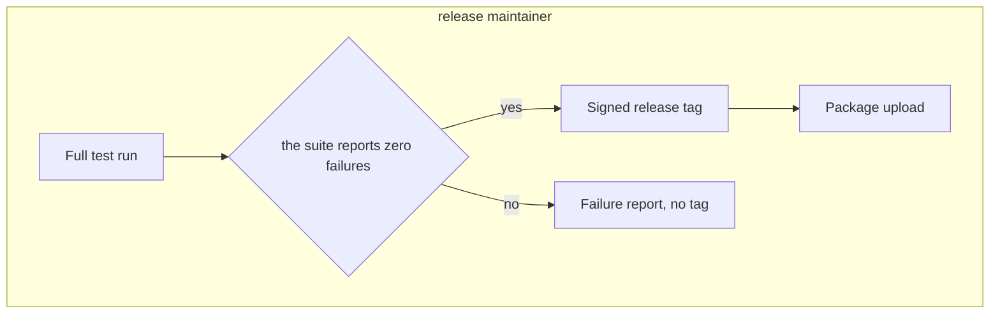

# Procedures as graph nodes

A procedure ("how we do X") can live in the graph as a node, with its steps as nodes of their own. An agent then finds procedures by name, fetches one when it needs it, sees its steps drawn from the current graph, and follows the links to the decisions and invariants the procedure exists to keep. This is procedural memory in the sense of the README's agent-memory section.

This guide uses a small example corpus, [`docs/procedures-example/`](procedures-example/): the release procedures of an invented project called Kestrel. Everything below was run against it, and `tests/test_procedures_example.py` keeps the claims marked *(tested)* true.

## 1. The shape of a procedure node

A procedure is a node whose id starts with `PROC-`. Its properties say when it applies and who owns it:

```
## [PROC-RELEASE-FROM-MAIN] Release from the main branch

- trigger: the maintainers agree that the main branch is ready to ship a new version
- owner: release maintainer
- status: active
- tools: the test runner; version control with signed tags; the package index upload command
- must-not: publish from a working copy with uncommitted changes
- last-reviewed: 2026-10-29
- implements: [DEC-SIGNED-RELEASE-TAGS]
- depends-on: [INV-TESTS-PASS-BEFORE-TAG]
```

- `trigger`, `owner` and `status` are the fields an agent needs before anything else: does this apply, whose is it, is it live.
- `must-not` records the step people get wrong.
- `implements` and `depends-on` are relationship keys, so they create typed edges to the decision the procedure carries out and the invariant it relies on. `lts_reverse` on the decision then lists the procedure among its referrers, through an `IMPLEMENTS` edge, which answers "which procedures implement this?" *(tested)*. The document's root node is listed there too, through `CONTAINS`.

These property names are this example's choice, not a fixed schema. Section 5 shows how a domain profile makes them required.

## 2. Steps, in order, with a decision

Each step is its own node. `part-of` makes it a member of the procedure; `next-step` orders it; a step with a `condition` is a decision, and `if-true` / `if-false` name where each answer leads:

```
### [STEP-TESTS-GREEN] Test result check

- part-of: [PROC-RELEASE-FROM-MAIN]
- actor: release maintainer
- action: read the test summary
- condition: the suite reports zero failures
- if-true: [STEP-SIGN-TAG]
- if-false: [STEP-FAILURE-REPORT]
```

`lts_flow(corpus, start_node="PROC-RELEASE-FROM-MAIN")` draws the procedure from the live graph as a Mermaid diagram, with the decision step as a diamond and the steps grouped by `actor` *(tested)*:



Nothing is stored: the diagram is rebuilt from the nodes on each call, so editing a step changes the next drawing.

## 3. Finding procedures: names first, the body when needed

An agent does not need every procedure's text at the start of a session, only their names, so that it recognises when one applies. Then it fetches the one it needs.

- **Names, once per session.** `lts_find(corpus, prefix="PROC-", tier="digest")` returns every procedure's id and title, complete and without bodies *(tested: both example procedures, nothing else)*.
- **The body, at the moment it applies.** `lts_node(corpus, node_id="PROC-RELEASE-FROM-MAIN")` returns its properties and edges.

Some agent harnesses put the list of names into an agent's instructions at launch, so the agent never has to ask. The Gnomon engine does this with its definition macros. That is a feature of the harness, not of this repository; without such a harness, the agent makes the `lts_find` call above itself at the start of each session.

## 4. Choosing between procedures: a decision matrix

When several procedures could apply, a matrix node records how to choose:

```
## [MATRIX-WHICH-RELEASE-PROCEDURE] Which release procedure to follow

- question: which procedure does a given release need
- rule: read the rows in order and follow the first whose need matches
- row-1-need: a fix for a defect in the released version, with nothing else
- row-1-use: PROC-HOTFIX-RELEASE
- row-2-need: a new version from the main branch
- row-2-use: PROC-RELEASE-FROM-MAIN
- row-3-need: anything else
- row-3-use: no release; raise it with the maintainers
- see-also: [PROC-HOTFIX-RELEASE]
- see-also: [PROC-RELEASE-FROM-MAIN]
```

The rows are plain properties, so the order and wording are the author's. The `see-also` lines make the edges to the procedures, so the matrix shows up when an agent asks what refers to a procedure. The last row says what to do when nothing matches, so the matrix never leaves the reader without an answer.

## 5. Keeping procedures well formed: a profile whose rules fire

Two separate mechanisms keep procedure nodes well formed.

**The typed writers** (`lts_add_node`, `lts_add_property`) refuse a malformed property key and check, after every write, that the file changed by exactly the intended edit. They know nothing about what a procedure needs.

**A domain profile** declares what a procedure needs. The example's [`procedures-profile.lts`](procedures-example/procedures-profile.lts) registers the `PROC-`, `STEP-`, `DEC-`, `INV-`, `MATRIX-` and `DOC-` prefixes. It requires `trigger`, `owner` and `status` on every `PROC-` node, recommends `must-not` and `last-reviewed`, requires `actor` and `action` on every `STEP-` node, and allows `status` to be only `draft`, `active` or `retired`.

A profile only does anything when it is in scope. `lts_lint` reports how it chose one in `profile.resolved_from`: an explicit `profile` argument, the corpus registry's `profile` key, or a `*-profile.lts` file in the corpus directory (auto-discovery, which is how this example works with no registry at all). If none applies, the result says so (`resolved_from: none`, `available: false`) and the profile-driven checks did not run. A clean lint with no profile in scope therefore checked nothing about procedures.

The example lints clean with its profile in scope *(tested)*. The control is what makes that clean result mean something: add a procedure without an `owner` and a step without an `action`, and lint reports exactly those two missing required properties (validator V3) *(tested)*. Move the profile out of the directory and the same violations produce no profile findings at all, because no profile is in scope. What you see instead is a set of `undeclared_key` errors, one per property key the example uses: the files are stamped `lts: "1.1"` (see below), and with the profile gone nothing declares their keys. *(tested)* Profile findings are warnings by default (a deployment can raise a validator's severity).

Two details caught us while writing the example:

- Both files are stamped `lts: "1.1"`, which makes an undeclared property key a lint **error**. That includes the profile's own structural keys (`registers-prefix`, `families`, `required` and so on), so the profile declares them too.
- With `dangle: true`, lint reports the document root, the first step and the matrix as orphans: nothing points at them. They are entry points, which nothing points at by nature, so the example leaves those three warnings rather than inventing edges to silence them *(tested)*.

## 6. Owners and review

`owner` says who answers for a procedure, and `last-reviewed` says when someone last checked it against reality. Because they are properties, the engine can answer questions about them directly. The procedure reviewed longest ago:

```
lts_find(corpus, prefix="PROC-", order_by={"field": "last-reviewed", "direction": "asc"}, limit=1)
```

In the example this returns `PROC-HOTFIX-RELEASE`, last reviewed 2026-03-02. Adding `where=[{"key": "status", "equals": "active"}]` restricts it to live procedures, and returns `PROC-RELEASE-FROM-MAIN` *(tested)*.

## Try it

From a clone, with the package installed as in the README's quick start:

```bash
python3 -m factlattice_engine call lts_lint --args-json '{"source": "docs/procedures-example"}'
echo "{\"procedures\": {\"root\": \"$PWD/docs/procedures-example\", \"domain_suffix\": \"example.procedures\"}}" > registry.json
export FACTLATTICE_CORPUS_CONFIG="$PWD/registry.json"
python3 -m factlattice_engine call lts_find --args-json '{"corpus": "procedures", "prefix": "PROC-", "tier": "digest"}'
python3 -m factlattice_engine call lts_flow --args-json '{"corpus": "procedures", "start_node": "PROC-RELEASE-FROM-MAIN"}'
```

The lint needs no registry: it finds the profile in the directory. The other calls name the corpus, so they need the one-entry registry. They also print a `PROFILE REGISTRATION DISAGREEMENT` note on stderr, because the registry entry above does not name the profile file that sits in the corpus root. The results are unaffected.
